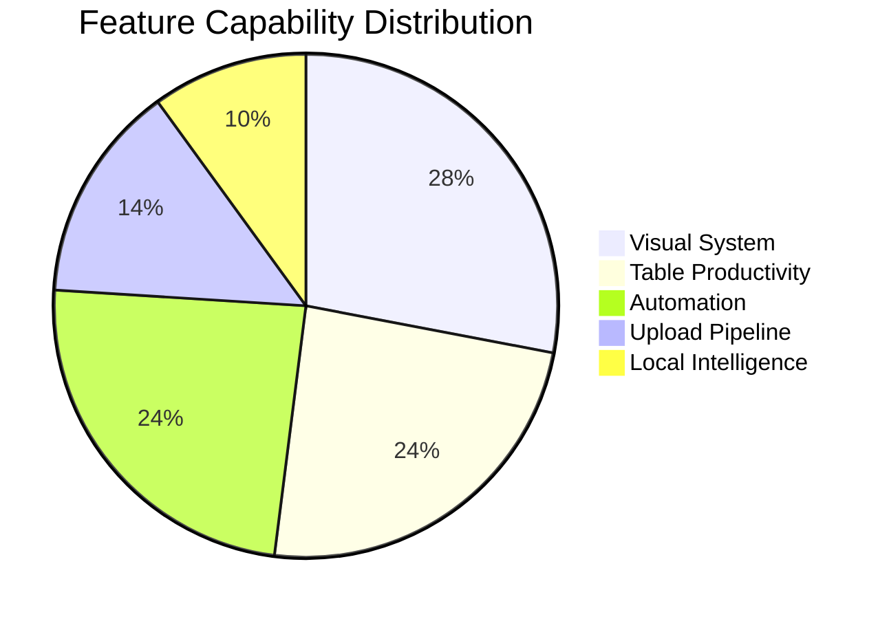
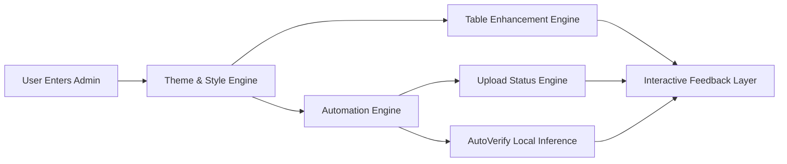
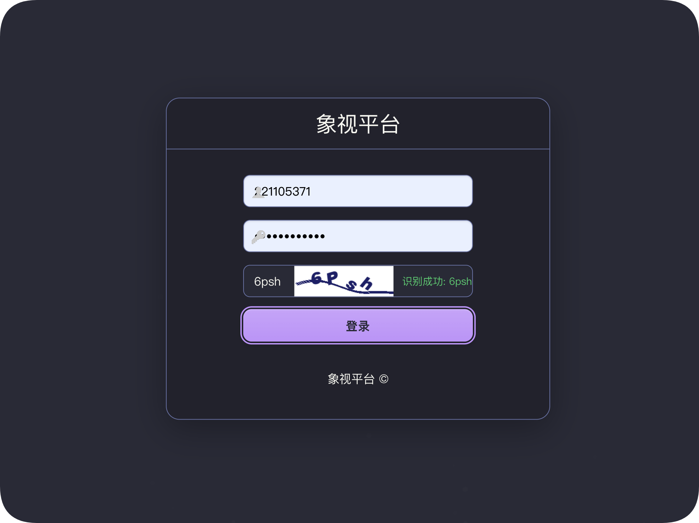
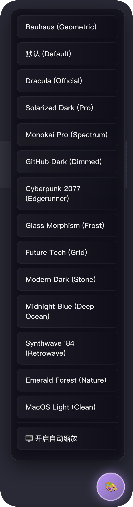
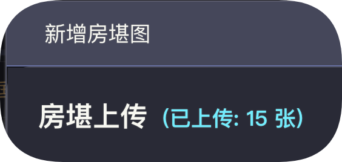
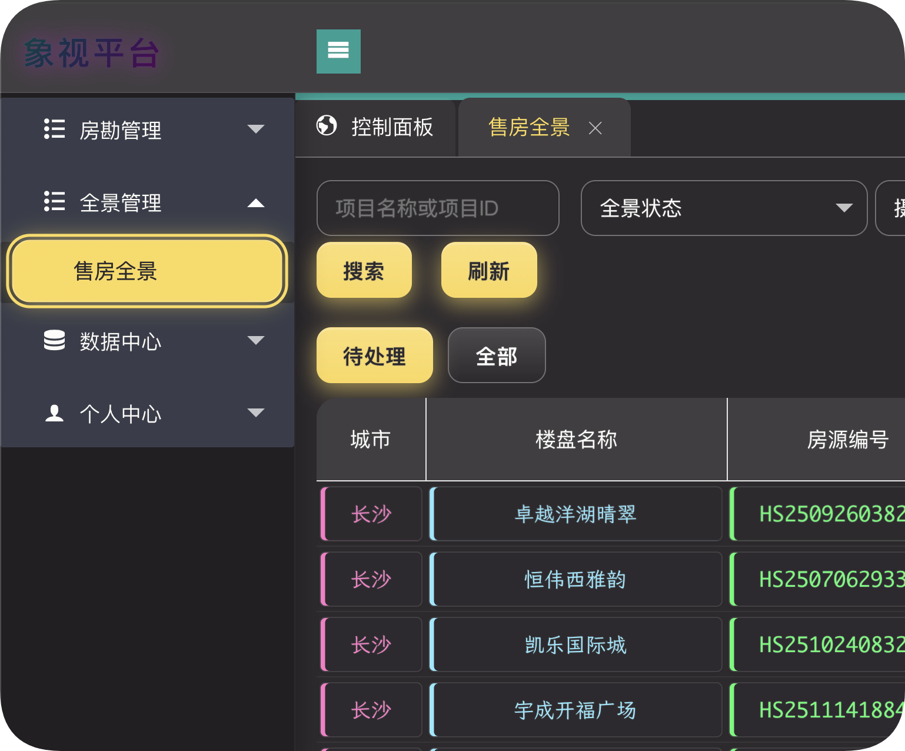
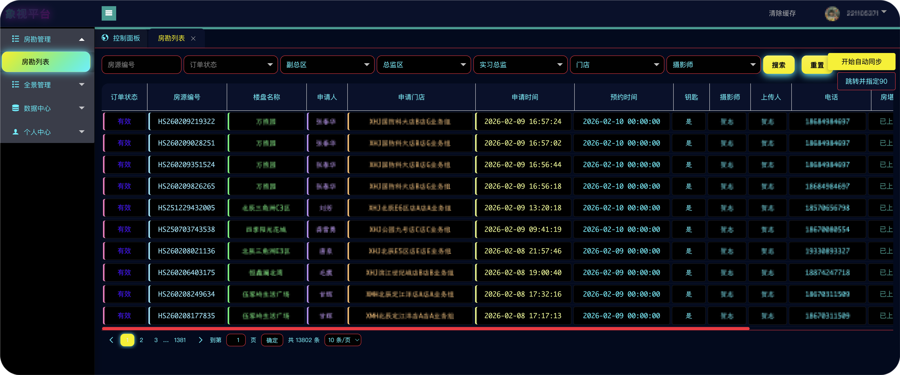

# 🌌 Xiangshi Platform Assistant · XHJ VR Assistant

## 2026-11-03 · v6.2.0

Table fields now use distinct text colors, with separate colors for order and panorama statuses. Fixed panorama table header alignment and removed the redundant inner close icon from the survey upload dialog while retaining the outer close and Cancel controls.

Unified all 16 themes around Soft UI while retaining their palettes: matching surfaces, upper-left lighting, dual shadows, 12/20px radii, smaller hover shadows, inset pressed states and shallower focused inputs. No floating buttons, glow or gradient decoration. Transitions use 300ms ease-in-out with reduced-motion support.

Theme-derived column tones follow fields through reordering and fixed copies. Status text remains semantic and readable. Local checks cover 688 rendered component contrast pairs, 1536 column/status pairs, 13 distinct column tones per theme, desktop and 390px layouts, and existing business regressions. The panorama list and survey upload dialog were checked in Chrome with the installed userscript and current theme; other themes and business operations were not individually verified live.

## 2026-10-27 · v6.1.3

Live verification identified Layui 2.5.7: its retained `page.limit` overrides the top-level limit, leaving v6.1.2 at 10 rows. Both values now use 90 for accepted-order reloads. The browser regression fixture now uses the site's actual 2.5.7 modules. Verified in the user’s Chrome/Tampermonkey session: accepted orders remain selected at 90 rows per page, and the first sync from the default list triggers all five current orders. The 90-row case is covered by same-version local replay; backend success counts are not independently confirmed.

## 2026-10-27 · v6.1.2

Fixed both order buttons in userscript isolation and late-loading scenarios using `unsafeWindow` and the native Layui table API. Accepted orders, 90 rows and page 1 load together after the initial request. Synchronization remains limited to the current page; “started” does not claim backend success.

Unified readable component colors across 16 themes, including Anthropic. Fixed pending/failed panorama counts, marked-row visibility and counter wrapping. Local delayed Layui replay, isolation tests and 688 rendered component contrast checks pass. Installed Tampermonkey behavior on the live site remains unverified. See the [compatibility report](work/xhj-20261026/compatibility-review.md).

## 2026-10-26 · v6.1.1

Fixed unintended form submission when opening accepted orders, and the first sync using only 10 rows. The script waits for the initial response, reloads accepted orders with 90 rows and page 1 in one request, and starts synchronization only after the complete response. Existing filters remain. Batch scope is the current accepted-order page (up to 90 rows), without automatic cross-page synchronization. Failed or incomplete loads do not start synchronization.

Added the Anthropic theme (16 themes total), inspired by [Anthropic's website](https://www.anthropic.com/): warm paper, charcoal, clay accents, serif headings, and restrained shadows. Author: `@Jhih he`.

Regression: `node tests/order-workflow.test.js`; local browser fixture: `python3 tests/order-preview-server.py` (Layui 2.6.8 with delayed synthetic responses, port 8766).

## 2026-09-14 · v6.1.0

Refreshed 13 accessible rendered DOM documents with inline scripts and 43 referenced assets in `work/xhj-20260914/`. This is not an archive of raw server responses, backend code, or every business record.

Unified spacing, button geometry, upload action groups, and semantic theme colors using the Apple Design skill's main principles. All 112 semantic color pairs across 14 styled themes meet 4.5:1; the default theme preserves the site. Fixed hardcoded table/status colors and added short interaction feedback with reduced-motion support.

Validated syntax, distribution parity, theme switching, route detection, isolated page initialization, and a 390px upload replay. Existing business modules remain; live upload, synchronization, deletion, and CAPTCHA recognition were not exercised. Enable only one distribution script. Account-visible snapshots remain local.

> A production-grade enhancement suite for Xiangshi Admin: **premium theming + table productivity + workflow automation + upload pipeline optimization + local intelligence**.

---

## 📌 Contents

- [Highlights](#highlights)
- [Latest Update v6.0.0](#latest-update-v600)
- [Feature Panorama](#feature-panorama)
- [Theme Matrix](#theme-matrix)
- [Charts & Diagrams](#charts--diagrams)
- [Installation & Deployment](#installation--deployment)
- [Technical Overview](#technical-overview)
- [Versioning Policy](#versioning-policy)
- [Screenshots](#screenshots)
- [FAQ](#faq)
- [Disclaimer](#disclaimer)

## Highlights

- Rebuilt visual hierarchy for dense admin pages with Apple-inspired native typography, clear hierarchy, and semantic status colors.
- Table-first productivity: column persistence, row double-click copy, status highlights.
- Automation toolkit: auto-sync, smart scaling, upload retry, dynamic observers.
- Local intelligence: ONNX-based CAPTCHA workflow without external API keys.
- Cross-context consistency: main pages, modal layers, and iframes stay aligned.

## Previous Release v6.0.0

- **Re-crawled and re-adapted to the live admin DOM**: Covers the main shell, survey list, panorama list, personal data, profile, and both survey/panorama upload flows.
- **Apple-inspired Control Center**: Adds theme swatches, smart-scale controls, a percentage slider, and one-click recommended defaults. Apple Light is now the default.
- **Accessibility and compact-screen improvements**: Keyboard focus, ARIA state, reduced motion, high contrast, and mobile safe areas are supported.
- **Existing capabilities preserved**: 15 themes, table hooks and column persistence, double-click copy, batch sync, upload counting/retry, smart scaling, and local ONNX CAPTCHA recognition.

## Feature Panorama

### 🎨 Visual System
- 16 built-in themes (dark / neon / glass / cyber / bauhaus / Anthropic styles).
- Unified design language for table, button, input, modal, and pager.
- Semantic color boost for faster visual scanning and action priority.

### 📊 Table Productivity
- `layui.table` render hook enhancements.
- Persistent header config (column order + visible/hidden states).
- Double-click row to copy house source number.
- Light status highlighting by business state.
- Scenario-specific layout tuning for survey list and panorama management.

### ⚡ Automation
- Batch auto-sync to reduce repetitive clicks.
- Toggleable smart scaling with per-page guard strategy.
- Failed upload detection and quick retry entrance.
- MutationObserver + fallback polling to keep enhancements alive on dynamic pages.

### 🧠 Local Intelligence
- AutoVerify powered by ONNX Runtime (local inference).
- Auto-locate CAPTCHA image and input field, then fill recognition result.
- Better privacy and lower external dependency risk.

## Theme Matrix

| Category | Themes |
|---|---|
| Dark Stack | Dracula, Monokai Pro, Solarized Dark, GitHub Dark, Modern Dark, Midnight Blue |
| Neon Stack | Cyberpunk 2077, Synthwave '84', Star Wars HUD, Future Tech |
| Material Stack | Glass Morphism, Bauhaus |
| Nature Stack | Emerald Forest |
| Light Stack | Apple Light |
| Warm Editorial | Anthropic |
| Baseline | Default |

## Charts & Diagrams

### 1) Capability Distribution

### 2) Runtime Flow

### 3) Release Timeline

```mermaid
timeline
    title XHJ Assistant Release Line
    5.0.19 : Content visibility fix after menu switching
    5.0.20 : Rollback of high-risk layout overrides
    5.0.21 : Top-bar scroll jitter fix on main/popup contexts
    5.0.22 : README overhaul + Git/Greasy script sync
    5.0.26 : Mobile button visibility adaptation and layout stability refinement
    5.0.27 : Dynamic observer scheduling optimization and interaction pipeline load reduction
    5.0.28 : Add-survey-image modal upward positioning and drag behavior fix
    5.0.29 : Add-survey-image action-button anti-flicker migration fix
    5.0.30 : Uploaded-counter delayed update fix
    5.0.31 : Accepted-order 90-per-page default and auto-sync pre-navigation
    5.0.33 : Accepted-order 90-per-page default and auto-sync pre-navigation
    5.0.34 : Accepted-order 90-per-page default and auto-sync pre-navigation
    5.0.35 : Panorama upload status neon color unification and readability boost
    5.0.36 : Fixed multi-line panorama upload status coloring
    5.0.39 : Panorama counter color transitions from red to green based on success ratio
    5.0.40 : Global typography optimization and theme-exclusive upload FX
    5.0.41 : Unified Design System & High-Performance Motion Engine via ui-ux-pro-max
    5.0.42 : Add-survey-image 'Clear All' button layout optimization
    6.0.0 : Live-DOM page adapter and Apple-inspired Control Center
```

## Installation & Deployment

### Install via Tampermonkey
1. Install Tampermonkey on Chrome / Edge / Firefox.
2. Install and enable one of the distribution scripts.
3. Open `https://vr.xhj.com/houseadmin/` and refresh.

### GreasyFork (3 scripts)

- [Script 534783](https://greasyfork.org/en/scripts/534783)
- [Script 563982](https://greasyfork.org/en/scripts/563982)
- [Script 563997](https://greasyfork.org/en/scripts/563997)

### GitHub

- [Repository](https://github.com/jhihhe/XHJ-VR-assistant)
- [Issues](https://github.com/jhihhe/XHJ-VR-assistant/issues)
- [Commits](https://github.com/jhihhe/XHJ-VR-assistant/commits/main)

## Technical Overview

| Dimension | Detail |
|---|---|
| Script Type | Tampermonkey Userscript |
| Core Language | JavaScript (ES6+) |
| UI Stack | Layui + Element UI mixed ecosystem |
| Mechanisms | CSS variables, DOM hooks, event injection, MutationObserver |
| Intelligence | ONNX Runtime Web (local inference) |
| Coverage | Main pages + Layer modals + iframe pages |

## Versioning Policy

- Semantic versioning flow: `5.0.8 → 6.0.0`.
- Every release synchronizes:
  - main file `xhj_assistant.user.js`
  - three Greasy distribution files
  - version badges and descriptions in both READMEs

## Screenshots

## FAQ

### Q1: Theme changes are not visible
- Ensure script is enabled in Tampermonkey.
- Ensure URL matches `@match` rules.
- Hard refresh with `Ctrl/Cmd + Shift + R`.

### Q2: Why header configuration is not saved
- Complete column adjustment first, then click save.
- Config is persisted per-page-path in local storage.

### Q3: Does it modify backend data
- No. It focuses on frontend UX and workflow efficiency only.

## Disclaimer

- This project is for compliant productivity and UX improvements.
- If upstream DOM/business structure changes significantly, adaptation updates may be required.
- Issues and PRs are welcome.
