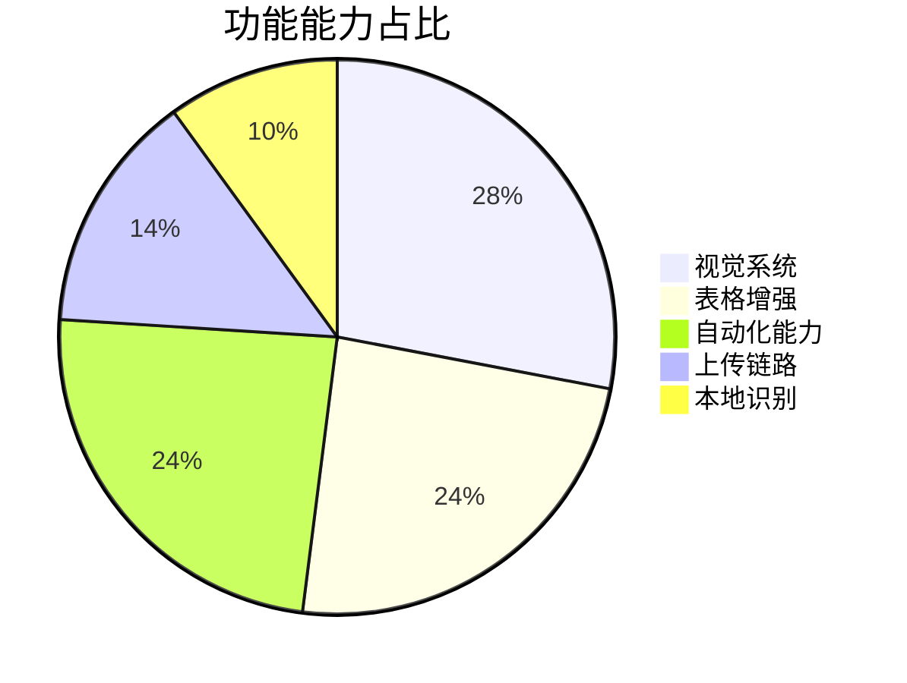
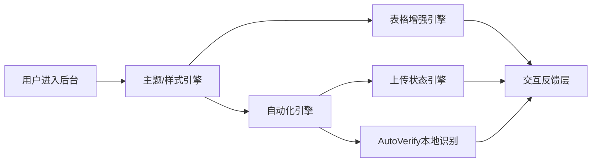
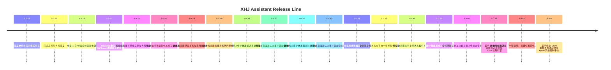

# 🌌 象视平台助手 · XHJ VR Assistant

## 2026-11-03 · v6.2.1

- 新增“上传房堪”：选择每日拍摄文件夹，解析含完整 HS 编号的房源目录，勾选后逐单上传；备份和无编号目录跳过。
- 客厅封面先完成，其余图片按4/8/12/16/20并发上传，默认8；新图齐全并核对原订单未变化后才替换保存，不提前清除旧图。
- 紧凑居中列表、主题彩色文字；两种可上传状态为绿色，无效为红色。显示工号及登录失效提示。
- 保存、回写、详情核对分阶段报告；可点击状态查看原因，失败后仍可选择和查询，再次上传需确认。
- 验证：11项上传相关测试、四发行副本一致性及主题回归通过；真实目录扫描和10项只读查询通过。单房源重拍已有实站验证，新单首次上传仍缺真实样本，不宣称全部业务场景已验收。
- 浏览器需手动选择目录；会话有效期由平台决定。三个发行页面选择其一启用。
- 使用方式与结果核对：[房堪上传说明](docs/survey-upload.md)。

## 2026-11-03 · v6.2.0

- 列表各字段使用不同文字颜色，订单和全景状态以不同颜色突出；修复售房全景表头与内容错位。
- 房勘上传窗口隐藏重复的内层关闭图标，保留外层关闭和底部取消。

- 全部 16 套主题统一为新拟物交互，保留各主题色系；柔和同色表面、12/20px 圆角、左上亮右下暗双阴影，移除浮动、发光和渐变装饰。
- 按钮悬停缩影、按下内凹；输入框聚焦减浅内阴影，保留键盘焦点；统一 300ms ease-in-out，支持减少动效。
- 列表按字段分配主题内差异底色及可读文字，重排后跟随字段，表头、正文和固定副本一致；状态文字继续区分成功、警告、失败。
- 验证：16 套主题的 688 组实际组件文字对比度、1536 组列文字/状态对比度及 13 列实际色差检查通过；桌面与 390px 回放已检查。订单、上传等既有回归通过。新版已在 Chrome 油猴中检查房勘上传窗口及当前主题下的全景列表，其他主题和业务操作未逐一实站验收。
- 设计与范围：[新拟物设计说明](docs/plans/2026-11-03-soft-ui-design.md)。本地证据：`work/xhj-20261103/`。

## 2026-10-27 · v6.1.3

实站确认使用 Layui 2.5.7：其旧 `page.limit` 会覆盖表格顶层 `limit`，导致 v6.1.2 跳转后仍为 10 条并中止同步。现在同时设置 `limit: 90` 和 `page.limit: 90`，手动已接单搜索同样处理；订单回放改用实站的 2.5.7 组件。已在用户 Chrome 油猴环境验收：跳转保持已接单、90 条/页；从默认列表首次同步完整发起当前 5 条订单操作。90 行覆盖另由同版本本地回放验证，后端成功数量未独立核实。

## 2026-10-27 · v6.1.2

- 修复油猴隔离环境及延迟注入时两个订单按钮无效：通过 `unsafeWindow` 访问原站 Layui，等待原始请求完成后直接加载已接单、90 条、第 1 页。按钮保持普通按钮，避免提交表单。
- 同步范围仍为当前已接单页最多 90 条；提示“已发起”表示触发操作，不代表服务端全部成功。
- 统一 16 套主题的导航、表格、弹窗、上传状态、辅助文字和危险操作颜色；新增 Anthropic 暖纸色主题。修复全景待上传/失败图片漏计、标记房源不显眼、上传计数挤压换行。
- 本地真实 Layui 延迟加载回放和隔离环境测试通过；16 套主题 × 43 组实际组件对比度通过。REA 对比及验收边界见 [兼容性报告](work/xhj-20261026/compatibility-review.md)。尚未确认用户浏览器中油猴安装后的实站结果。

## 2026-10-26 · v6.1.1

- 修复“跳转到已接单”触发表单提交后刷新回全部订单：助手按钮显式使用普通按钮，阻止默认提交。
- 修复首次同步只处理 10 条：等待初始加载完成，再用一次表格重载同时提交已接单筛选、90 条分页和第 1 页；等完整响应后开始同步。保留当前房源、门店及摄影师等筛选。这里的批量同步范围仍是当前已接单页（最多 90 条），不会自动跨页。
- 移除定时触发分页变化的逻辑，避免和搜索请求竞争；请求失败或响应不完整时终止同步并允许重试。
- 新增 Anthropic 主题（共 16 套）：参考 [Anthropic 官网](https://www.anthropic.com/) 的暖米色、炭黑、陶土点缀、衬线标题与克制阴影，不依赖外部字体。
- 作者署名：`@Jhih he`。

验证：`node tests/order-workflow.test.js` 覆盖初始加载、90 条/不足 90 条、重复点击、错误/不完整响应和筛选保留；`python3 tests/order-preview-server.py` 提供真实 Layui 2.6.8 + 2.5 秒延迟的本地模拟订单页（端口 8766）。

## 2026-09-14 · v6.1.0

- 重新采集 13 个账号可访问页面的完整渲染 DOM/内联脚本及 43 个引用资源，归档位于 `work/xhj-20260914/`。它不是服务器原始响应或后端源码，也不是全站所有业务记录的镜像。
- 使用 Apple Design 主文档原则统一文字、间距、控件尺寸和操作分组。14 个美化主题的 112 组语义色通过至少 4.5:1 对比度检查；默认主题保留原站外观。
- 修复跨主题固定彩色文字和状态段落的内嵌颜色；统一主操作、次操作、警告、危险配色。保留各主题色系和科技主题装饰。
- 房勘上传操作固定成清除/批量上传/确定分组，桌面及 390px 回放已检查。按钮、面板保留短促反馈，尊重减少动效设置。
- 保留既有业务模块。已验证源码语法、发行副本一致性、主题切换、路由识别和离线页面初始化；未执行线上上传/同步/删除提交或验证码识别实测。

安装：选择一个对应发行脚本替换旧版本，不要同时启用多个副本。源码归档含账号可见业务信息，默认仅保留在本地。

验证：`node tests/theme-contrast.test.js`、`node tests/refresh-behavior.test.js`、`node tests/userscript-static.test.js`。

> 为象视后台打造的一体化增强引擎：**高级主题美化 + 表格增强 + 自动化提效 + 上传链路优化 + 本地智能识别**。  
> 目标是让“高频后台操作”更快、更稳、更顺手。

---

## 📌 目录

- [项目亮点](#项目亮点)
- [最新更新 v6.0.0](#最新更新-v600)
- [功能全景](#功能全景)
- [主题矩阵](#主题矩阵)
- [图形图表](#图形图表)
- [安装部署](#安装部署)
- [技术概览](#技术概览)
- [版本策略](#版本策略)
- [预览截图](#预览截图)
- [FAQ](#faq)
- [免责声明](#免责声明)

## 项目亮点

- 高密度后台页面的视觉重构：Apple 风格的原生字体、清晰层级与语义状态色。
- 表格工作流增强：列配置保存、双击复制、状态高亮、操作区排版优化。
- 自动化能力集成：一键同步、自动缩放、上传重试、动态状态监测。
- 本地智能识别：ONNX 验证码识别链路，无需外部 API Key。
- 跨上下文一致：主页面、弹窗、iframe 风格与交互保持统一。

## 上一版 v6.0.0

- **按最新线上页面重新适配**：覆盖主控制台、房勘列表、售房全景、个人数据、个人资料以及房勘/全景上传页。
- **Apple 风格控制中心**：新增主题色卡、自动缩放开关、滑杆和一键恢复推荐设置，默认启用 Apple Light。
- **可访问性与窄屏优化**：支持键盘焦点、ARIA 状态、减少动效、高对比度与移动端安全区。
- **完整保留原有能力**：15 套主题、表格 Hook/列状态持久化、双击复制、批量同步、上传计数/重试、自动缩放与 ONNX 验证码识别。

## 功能全景

### 🎨 视觉系统
- 16 套主题快速切换（暗黑 / 霓虹 / 玻璃 / 赛博 / Bauhaus / Anthropic 等）。
- 表格、按钮、输入框、弹窗、分页统一材质与阴影层次。
- 状态语义色增强，扫描列表时一眼定位优先级。

### 📊 表格增强
- `layui.table` Hook 增强渲染流程。
- 表头配置可持久化（列显隐、列顺序保存/恢复）。
- 双击行自动复制房源编号，减少机械操作。
- 按业务状态进行浅色高亮（待接单/已接单/取消/无效）。
- 房堪列表/全景管理列宽与操作栏按场景优化。

### ⚡ 自动化能力
- 批量自动同步，减少重复点击。
- 自动缩放可开关 + 比例可调（页面场景智能禁用）。
- 上传失败项自动识别与重试入口。
- 动态内容监听（MutationObserver + 低频兜底）保持增强持续生效。

### 🧠 本地智能识别
- AutoVerify 基于 ONNX Runtime 的本地识别流程。
- 验证码图与输入框自动匹配，识别结果自动填入。
- 不依赖云打码服务，隐私与可控性更高。

## 主题矩阵

| 分类 | 主题 |
|---|---|
| 深色系 | Dracula、Monokai Pro、Solarized Dark、GitHub Dark、Modern Dark、Midnight Blue |
| 霓虹系 | Cyberpunk 2077、Synthwave '84'、Star Wars HUD、Future Tech |
| 质感系 | Glass Morphism、Bauhaus |
| 自然系 | Emerald Forest |
| 浅色系 | Apple Light |
| 纸感编辑风格 | Anthropic |
| 基线 | Default |

## 图形图表

### 1) 能力分布图

### 2) 执行流程图

### 3) 版本推进图

## 安装部署

### Tampermonkey 安装
1. 安装浏览器扩展 Tampermonkey（Chrome / Edge / Firefox）。
2. 选择对应脚本安装并启用。
3. 打开 `https://vr.xhj.com/houseadmin/` 并刷新页面。

### GreasyFork 三脚本

- [脚本 534783](https://greasyfork.org/zh-CN/scripts/534783)
- [脚本 563982](https://greasyfork.org/zh-CN/scripts/563982)
- [脚本 563997](https://greasyfork.org/zh-CN/scripts/563997)

### GitHub

- [项目主页](https://github.com/jhihhe/XHJ-VR-assistant)
- [问题反馈](https://github.com/jhihhe/XHJ-VR-assistant/issues)
- [提交记录](https://github.com/jhihhe/XHJ-VR-assistant/commits/main)

## 技术概览

| 维度 | 说明 |
|---|---|
| 脚本类型 | Tampermonkey Userscript |
| 核心语言 | JavaScript (ES6+) |
| UI 场景 | Layui + Element UI 混合 |
| 核心机制 | CSS 变量主题、DOM Hook、MutationObserver、事件注入 |
| 智能识别 | ONNX Runtime Web（本地推理） |
| 适配范围 | 主页面 + Layer 弹窗 + iframe |

## 版本策略

- 采用语义化版本：`5.0.8 → 6.0.0`。
- 每次发布同步更新：
  - 主脚本 `xhj_assistant.user.js`
  - Greasy 三脚本 `xhj_assistant_534783.user.js / xhj_assistant_563982.user.js / xhj_assistant_563997.user.js`
  - `README.md` 与 `README-EN.md` 版本徽章与说明

## 预览截图

## FAQ

### Q1：主题没有生效？
- 检查脚本是否启用。
- 检查当前 URL 是否命中 `@match`。
- 使用 `Ctrl/Cmd + Shift + R` 强刷。

### Q2：表格配置为什么没有保存？
- 先在表头工具中完成调整，再点击“保存表头状态”。
- 配置按路径维度保存在本地存储，不同页面独立。

### Q3：会影响后台数据吗？
- 不会。脚本聚焦前端展示、交互和流程提效，不改后端协议。

## 免责声明

- 本项目仅用于提升后台操作效率与体验，请在合规场景使用。
- 若目标页面 DOM 或业务结构大改，可能需要同步适配脚本。
- 欢迎 Issue / PR 一起完善稳定性和可维护性。
