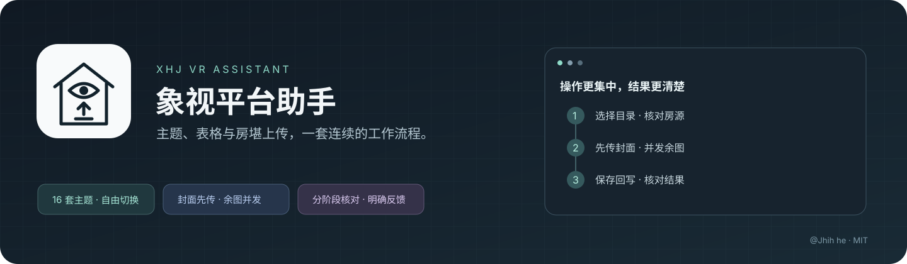
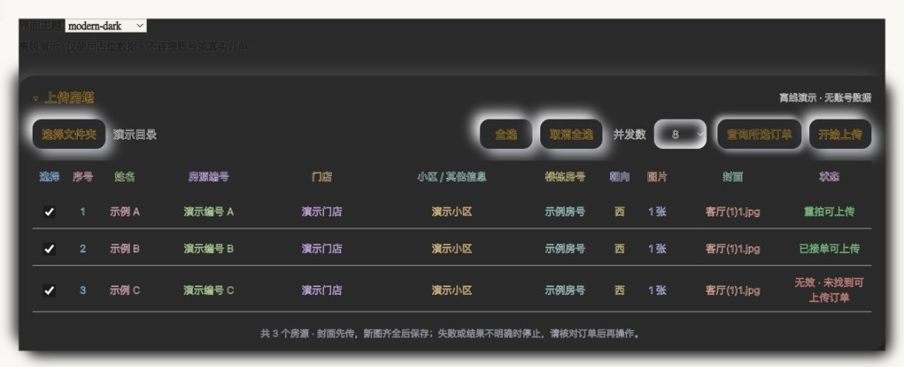
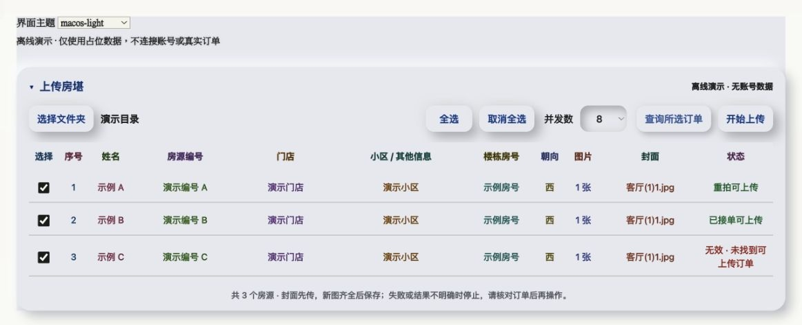
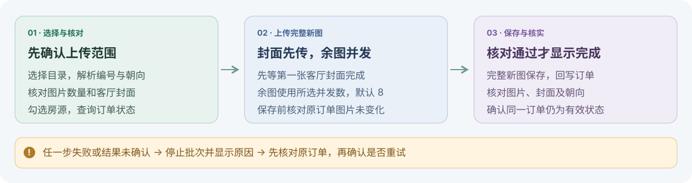

<div align="center">



<br>

[](https://github.com/jhihhe/XHJ-VR-assistant/releases/latest)
[](LICENSE)
[](https://github.com/jhihhe/XHJ-VR-assistant/commits/main)
[](https://github.com/jhihhe/XHJ-VR-assistant/issues)


**让象视后台的高频操作更集中，让上传结果更容易核对。**

[立即安装](#安装) · [界面展示](#界面展示) · [房堪上传](#房堪上传流程) · [更新日志](CHANGELOG.md) · [反馈问题](https://github.com/jhihhe/XHJ-VR-assistant/issues)

</div>

> [!TIP]
> 当前版本 **6.3.9**，房堪上传模块 **0.6.2**，售房全景模块 **0.3.0**。三个油叉入口功能一致，**选择一个启用即可**。

## 功能一览

<table>
<tr>
<td width="33%"><strong>主题与界面</strong><br><br>16 套主题，统一按钮、输入框、弹窗和分页；适配深浅配色、键盘焦点与减少动效。</td>
<td width="33%"><strong>表格与操作</strong><br><br>字段配色、状态区分、列配置保存、双击复制编号，以及主页面与 iframe 的一致排版。</td>
<td width="33%"><strong>每日房堪上传</strong><br><br>选择目录，解析 HS 编号和朝向；封面先传，余图按所选并发数上传，完成后保存核对。</td>
</tr>
<tr>
<td><strong>紧凑操作区</strong><br><br>标题和工号一行；目录、勾选、并发、查询、上传集中在下一行。窄窗口自动换行。</td>
<td><strong>清晰的结果反馈</strong><br><br>查询状态分色；保存、回写和核对分别报告，点击短状态查看具体原因，重复上传前确认。</td>
<td><strong>日常辅助</strong><br><br>当前已接单页批量同步、页面缩放、图片计数、重试入口及本地验证码识别。</td>
</tr>
</table>

## 界面展示

以下截图均来自**离线演示页面**，只使用占位数据，不包含真实账号、房源、订单或照片；演示状态不代表服务器上传结果。

### 深色界面 · 两行工具栏与状态配色



### 浅色界面 · 相同的操作顺序与字段层级



## 安装

1. 在浏览器安装并启用 [Tampermonkey](https://www.tampermonkey.net/)。
2. 从下方三个发行入口中任选一个安装，避免多个副本同时运行。
3. 登录象视后台并刷新页面；房勘列表中展开“上传房堪”。

<div align="center">

[](https://greasyfork.org/zh-CN/scripts/563997)
[](https://greasyfork.org/zh-CN/scripts/563982)
[](https://greasyfork.org/zh-CN/scripts/534783)

也可从 [GitHub Releases](https://github.com/jhihhe/XHJ-VR-assistant/releases/latest) 获取发行文件。

</div>

## 房堪上传流程



| 阶段 | 行为 |
|---|---|
| 选择目录 | 只解析下一层含完整 HS 编号的房源文件夹；备份和无编号目录跳过。浏览器仍需手动选择目录。 |
| 核对照片 | 显示解析字段、图片数量和客厅封面；缺少必要信息或同日编号重复时提示。 |
| 并发上传 | 封面先完成，其余图片支持 **4 / 8 / 12 / 16 / 20** 并发，默认 **8**。 |
| 替换保存 | 新图齐全且原订单未变化后才保存，**不提前清除旧图**；只填写首个房间朝向。 |
| 出现异常 | 停止当前批次，保留失败阶段和具体原因，不自动重复保存；失败项仍可勾选和查询。 |

### 状态怎么看

| 显示 | 含义 | 下一步 |
|---|---|---|
| 🟢 重拍可上传 | 对应有效订单，可进入重拍流程 | 核对文件后上传 |
| 🟢 已接单可上传 | 对应已接单订单，可进入上传流程 | 核对文件后上传 |
| 🔴 无效 | 没有唯一可上传订单等原因 | 查看提示，核对编号和订单 |
| 🟠 保存未确认 | 尚未取得可靠的保存确认 | 先检查服务器实际结果 |
| 🟠 已保存 · 回写待核实 | 图片保存已获服务器确认，后续回写尚未核实 | 点击详情，核对订单 |
| 完成 | 图片、封面、朝向及同一订单有效状态已核实 | 本次任务结束 |

> [!IMPORTANT]
> “可上传”只表示订单状态允许操作，**不代表上一轮上传已经成功**。遇到结果未确认时，先核对原订单；不要在原站一键清除后关闭窗口或空图确认。

完整说明见 [房堪上传指南](docs/survey-upload.md)。

## 售房全景上传

选择每日 `yyyyVR/mm月/mmdd` 文件夹，解析 HS 编号、房屋朝向和各楼层图片，再勾选上传。

- 根目录为一层，`2` 子目录为二层；一层完成后再上传二层。支持 2:1 JPG，全景图片单张不超过 50MB。
- 先查询当前工号（不指定摄影师），未找到才跨摄影师检索；可按人名设置“跨摄影师首查”，显示当前摄影师和查询进度。
- 同时房源可选 **1–5 套**，默认 **1**；图片并发 **4 / 8 / 12 / 16 / 20**，默认 **20**，所有上传房源共享此图片上限；坐标处理独立并行、不占上传名额。
- 上传后独立获取并核对每张图片的坐标，批量未齐自动逐张补取，可停止；全部图片和坐标准备完成后，才允许单独确认“保存所选朝向”。保存会分配设计师制作户型图。
- 重拍按平台流程下架原 VR 和户型图、转换订单后上传；未知旧图、文件变化或结果不明确时停止，保留本端核对记录，不自动重复派单。

完整步骤与验证范围见 [售房全景上传指南](docs/panorama-upload.md)。

## 主题矩阵

<details>
<summary><strong>查看全部 16 套主题</strong></summary>

| 风格 | 主题 |
|---|---|
| 浅色与基线 | Apple Light、Default |
| 深色 | Dracula、Solarized Dark、Monokai、GitHub Dark、Modern Dark、Midnight Blue |
| 科技与霓虹配色 | Star Wars HUD、Cyberpunk、Future Tech、Synthwave '84 |
| 其他色系 | Bauhaus、Glass Morphism、Emerald Forest、Anthropic |

主题保留各自配色，控件采用统一的新拟物交互；主题名称不表示仍使用旧版光效或液态玻璃实现。

</details>

## 验证与适用范围


| 验证层级 | 已完成 | 边界 |
|---|---|---|
| 本地回归 | 上传流程、错误阶段、发行副本一致性及主题相关检查 | 本地模拟不能代替服务器业务验收 |
| Chrome 实站 | 每日目录扫描、只读查询、紧凑排版及单房源重拍核对 | 没有逐一验收全部主题和全部业务组合 |
| 新单首次上传 | 流程及本地测试已覆盖 | 仍等待合适的真实订单和照片样本 |

<details>
<summary><strong>开发者：运行上传与发行检查</strong></summary>

需要支持全局 `File` 等 Web API 的现代 Node.js；当前本地验证环境为 Node.js 24。

```sh
for test in tests/survey-*.test.js; do node "$test" || exit 1; done
node tests/userscript-static.test.js
```

修改上传模块后重新组装四份发行脚本：

```sh
python3 work/xiangshi-upload-api/build_userscripts.py
```

本机安装更新使用带 UTF-8 声明的入口，避免直接查看源码时中文乱码：

```sh
python3 work/xiangshi-upload-api/serve_userscripts.py
```

随后打开 `http://127.0.0.1:8768/xhj_assistant.user.js`。该服务仅监听本机；油猴安装确认需手动完成。

模块源码位于 `work/xiangshi-upload-api/`；本机实站诊断资料和照片不属于发行内容。上述徽章是已记录的本地检查结果，不是持续集成的实时状态。

</details>

## 最近更新

**6.3.9 · 2026-11-05**

- 修复房堪保存前核对将 JSON 字段顺序差异误判为内容变化的问题；真实内容与图片顺序变化仍会拦截。
- 详情接口异常与原订单内容变化分别提示；保存前失败明确说明请求未发送、新图未关联、旧图未清除。

**6.3.8 · 2026-11-04**

- 图片上传和坐标处理独立并行：传完图片即释放房源上传名额，缺失坐标逐张补取，可停止后继续。
- 增加跨摄影师人名选择、查询排队与进度、摄影师缓存；所有订单仍先查当前工号。
- 支持同时1–5套房源，共享默认20张图片并发；失败停止排队，保存结果不明时阻止重复派单。

[查看完整更新日志 →](CHANGELOG.md) · [查看全部 Releases →](https://github.com/jhihhe/XHJ-VR-assistant/releases)

## 常见问题

<details>
<summary><strong>主题或新版本没有生效？</strong></summary>

确认脚本已启用、网址命中脚本的适用范围，并且只启用一个发行副本。更新后刷新象视页面；必要时强制刷新。

</details>

<details>
<summary><strong>能否自动打开当天文件夹？</strong></summary>

推荐路径会按上海日期更新，但浏览器不能让脚本无用户授权直接读取本机目录，仍需手动选择。完整推荐路径可悬停“选择文件夹”查看。

</details>

<details>
<summary><strong>会不会修改后台数据？</strong></summary>

主题与排版功能主要改变前端展示。用户点击上传或批量同步等业务操作时，脚本会向平台提交请求；请先核对选择范围和结果。登录有效期仍由平台决定，客户端与浏览器按平台限制顺序使用。

</details>

<details>
<summary><strong>表格列配置在哪里保存？</strong></summary>

列配置按页面路径保存在浏览器本地存储中；调整后使用表头状态保存功能。清理网站数据可能移除配置与本地核对记录。

</details>

---

**作者：@Jhih he** · [MIT](LICENSE) · [问题反馈](https://github.com/jhihhe/XHJ-VR-assistant/issues)

第三方组件及上游声明按各自来源保留。适用于有权操作的象视账号；平台页面或接口发生变化时可能需要重新适配。
